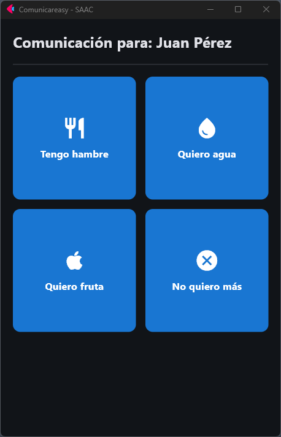

# Comunicareasy

An Augmentative and Alternative Communication (AAC) application developed in Python for stroke patients and their caregivers.

<p align="center">
  
</p>

<details>
<summary>More (upcoming) screenshots</summary>

<br>


</details>

## Background
Individuals who suffer recurrent strokes often experience progressive loss of speech (aphasia). They are also frequently left with mobility in only one arm (hemiparesis). Consequently, a simple communication tool helps both patients and their caregivers communicate more easily.

## Project Purpose
To provide a clean, high-contrast, and easy-to-use "tap-to-talk" interface that helps patients with communication difficulties express basic needs, emotions, and everyday phrases quickly and without cognitive friction.

## Technologies Used
- **Language:** Python 3
- **Graphical Interface:** Flet
- **Package Management:** uv & pyproject.toml
- **Version Control:** Git and GitHub

## Repository Structure
```text
comunicareasy/
├── docs/
│   └── images/
│       └── demo.png
├── src/
│   ├── assets/              
│   ├── models/                     # Data management and user data template
│   │   ├── __init__.py
│   │   ├── config.example.json
│   │   └── data_manager.py
│   └── main.py                     # Main application entry point
├── tests/
│   ├── __init__.py
│   └── test_data_manager.py
├── .gitignore
├── LICENSE
├── README.md
├── pyproject.toml
└── uv.lock
```

## Local Installation and Execution

Ensure you have Git and Python 3.10 or newer installed on your system. This project uses uv for fast, reliable dependency and environment management.

Open a terminal in the folder where you want the project, then run:

```
git clone https://github.com/alfonso-vasconez/comunicareasy.git
cd comunicareasy
```
If you don't have uv installed yet, you can quickly install it using your terminal:

Linux / macOS: 
```bash 
curl -LsSf https://astral.sh/uv/install.sh | sh
```
Windows (PowerShell): 
```powershell 
powershell -ExecutionPolicy ByPass -c "irm https://astral.sh/uv/install.ps1 | iex"
```

If the terminal doesn't recognize uv after installation, restart it to update the environment variables. You can also temporarily register the path by running the environment command that the terminal itself prompts you for after installation in your current session.

Check that the installation was successful by running:
```
uv --version
```
Once uv is ready, set up the project and run the application:

```bash
# Synchronize dependencies and set up the virtual environment automatically
uv sync

# Run the application
uv run flet run src/main.py
```
To run the unit tests with pytest:
```bash
uv run pytest
```

## Roadmap Phases
- [x] Phase 1: Initial environment and repository setup.
- [ ] Phase 2: Base data model design (categories and phrases).
- [ ] Phase 3: Main patient interface (high contrast / tap-to-talk).
- [ ] Phase 4: Configuration panel for caregivers.
- [ ] Phase 5: Testing and usability refinement.

## License
This project is licensed under the MIT License. See the LICENSE file for details.